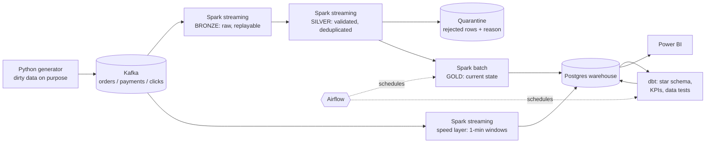

# Real-Time E-Commerce Analytics Platform

An end-to-end data engineering project: simulated shop events flow through **Kafka → Spark Structured Streaming → Delta Lake (Bronze/Silver/Gold) → Postgres warehouse → dbt → Power BI**, orchestrated by **Airflow**, with data-quality checks, fault tolerance, alerting and automated tests.

Everything runs locally with `docker compose` (Windows + Docker Desktop). No cloud account needed.

## Business questions it answers

| Question | Where it is answered |
|---|---|
| How many orders per minute? | `realtime.orders_per_minute` (streaming, ~10 s latency) |
| Which products sell the most? | `analytics.kpi_top_products` |
| Revenue by city? | `analytics.kpi_revenue_by_city` |
| Is the pipeline healthy / is data missing? | `lake_gold.quarantine_summary`, `monitoring.pipeline_metrics`, Airflow |
| How many orders fail or get cancelled? | `analytics.kpi_daily_summary`, `realtime.payments_per_minute` + `monitoring.alerts` |

## Architecture



**Two paths on purpose (a lightweight Lambda architecture):**
- *Speed layer* reads Kafka directly and gives fresh numbers within seconds (late events beyond the watermark are dropped here).
- *Batch layer* (Bronze → Silver → Gold → dbt) is the accurate source of truth: it includes late events and is rebuilt from the lake.

| Layer | Storage | Contains |
|---|---|---|
| Bronze | Delta `/lake/bronze/events` | Raw Kafka value + topic/partition/offset. Never modified. |
| Silver | Delta `/lake/silver/{clicks,orders,payments}` | Parsed, typed, validated, **deduplicated** events. `quarantine` holds rejected rows with reasons. |
| Gold | Delta `/lake/gold/*` → Postgres `lake_gold.*` | Current-state tables: latest order status, payment attempts, items. |
| Marts | Postgres `analytics.*` (dbt) | `fact_orders`, `fact_order_items`, `dim_*`, `kpi_*`. |

## Quick start

Requirements: Windows with Docker Desktop (WSL2 backend), **8 GB RAM available to Docker**, ~6 GB disk. In `%UserProfile%\.wslconfig` you can set `memory=8GB`.

```powershell
docker compose up -d --build     # first build downloads images + Spark jars (~10 min)
docker compose ps                # everything should be Up / Exited(0) for the init jobs
docker compose logs -f silver-stream
```

| Service | URL | Login |
|---|---|---|
| Airflow | http://localhost:8080 | admin / admin |
| Kafka UI | http://localhost:8081 | - |
| Postgres (for Power BI) | localhost:5432, db `warehouse` | de / de_password |

Within ~1 minute events flow; after the first Airflow run (every 10 min, or trigger `ecommerce_batch_pipeline` manually) the `analytics` schema is populated. Check the lake at any time:

```powershell
docker compose run --rm --no-deps bronze-stream python inspect_lake.py
```

Stop with `docker compose down` (add `-v` to wipe all data).

## Demo scenarios (great for a video / interview)

1. **Fault tolerance** - `docker compose kill silver-stream`, wait a minute, `docker compose up -d silver-stream`. It resumes from its checkpoint; run `inspect_lake.py` and show *no duplicates*.
2. **Payment incident + alert** - `docker compose run --rm -e INCIDENT_MODE=1 -e RUN_SECONDS=150 generator`. Failure rate jumps to ~60%; a row appears in `monitoring.alerts` and the Power BI alert card turns red.
3. **Data quality** - open `lake_gold.quarantine_summary`: nulls, negative amounts and malformed JSON were rejected with reasons, not silently dropped.
4. **Idempotency** - re-run the Airflow DAG twice; Gold and dbt results are identical.
5. **dbt tests catching bugs** - see `dbt/tests/` (reconciliation of order totals vs. items, revenue only when paid).

## Repository layout

```
generator/    event simulator + Kafka producer (dirty-data injection, incident mode)
spark_jobs/   bronze_stream, silver_stream, realtime_kpis, gold_batch  (+ quality.py, gold_logic.py = pure, tested logic)
airflow/dags/ ecommerce_batch_pipeline: sensor -> spark gold -> dbt seed/run/test, retries, failure alerts
dbt/          staging views, star schema, KPI marts, generic + singular tests, source freshness
sql/init.sql  warehouse schemas + realtime/monitoring tables
tests/        pytest: generator, data-quality rules, gold logic, streaming windows (real Spark)
docs/         INTERVIEW.md (architecture Q&A), POWERBI.md (data model, DAX, pages)
```

## Testing

```powershell
pip install pyspark==3.5.3 pytest psycopg2-binary   # needs Java 17 on PATH
pytest -q                                           # ~2 min: runs real local Spark sessions
```

Covers: generator determinism and dirty-data injection, every data-quality rule, malformed JSON handling, Gold lifecycle logic (cancel, payment retry), and the streaming window / dedup logic as a real Structured Streaming query. dbt adds 26 data tests (`dbt test`).

## Key design decisions

- **Kafka between generator and Spark**: decouples producers from consumers, buffers spikes, allows replay.
- **Bronze = raw string**: parsing bugs can't lose data; Silver can be rebuilt any time.
- **Idempotent Silver writes** (`MERGE` insert-only on `event_id`, `txnAppId/txnVersion` on quarantine): Kafka and Spark are at-least-once, so duplicates are handled by the sink, giving effectively-once results.
- **Quarantine instead of drop**: every rejected row keeps its raw payload and reason list.
- **Money as `DECIMAL(12,2)`**, never float.
- **Event time + watermark** for windows, not processing time.
- **Gold = current state**: events are collapsed (latest order status, latest payment attempt) so BI never has to reason about event streams.
- **dbt for the SQL layer**: versioned models, tests, docs and lineage; Spark stays focused on heavy/streaming work.
- **Airflow only for scheduled, dependent batch work**; streaming jobs are long-running services (Airflow is not a streaming engine).

## Limitations (be upfront about these in interviews)

- Spark runs in `local[*]` mode inside containers (one JVM per job), not on a cluster. The code is cluster-ready (change `SPARK_MASTER`), but this setup demonstrates the concepts, not horizontal scale.
- Kafka is a single broker (replication factor 1). Production would use >= 3 brokers.
- Delta `MERGE` scans the table for dedup; at real scale you would partition/prune on `event_date` and add Z-ordering/compaction (`OPTIMIZE`).
- Gold load to Postgres uses truncate + insert, so dashboards can briefly see an empty table during a run; production would swap tables or use staging + rename.
- Events of one session are emitted together with small timestamp offsets (no real think-time delays).

## Roadmap ideas

Schema Registry + Avro, Great Expectations, OpenLineage, Prometheus/Grafana metrics, CI that runs the full compose stack, deploying the same code to Databricks (Auto Loader + Delta Live Tables).
